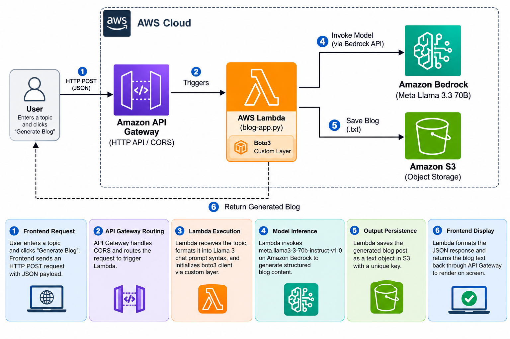
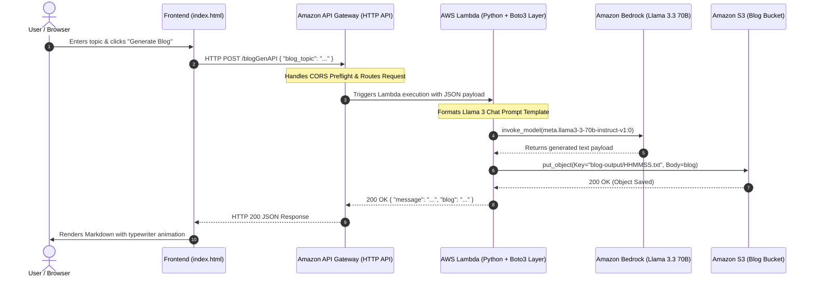
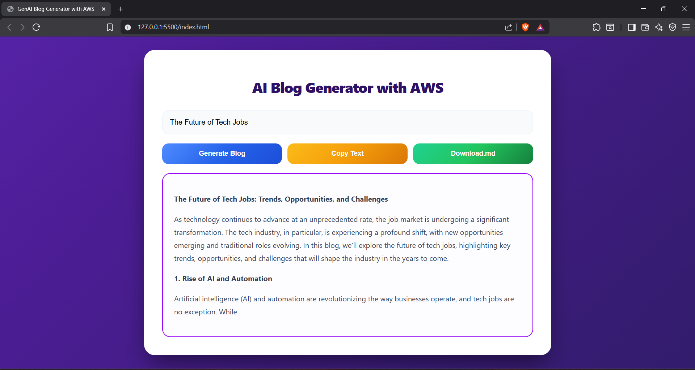

# 🚀 AI-Powered Blog Generator with AWS & Amazon Bedrock

An end-to-end, enterprise-grade, serverless Generative AI application built on Amazon Web Services (AWS). This solution transforms a user-provided topic into a professional, structured, 5-subtopic blog post within seconds using **Meta Llama 3.3 70B Instruct** on **Amazon Bedrock**, orchestrated seamlessly via **AWS Lambda**, **Amazon API Gateway (HTTP API)**, and persistent storage on **Amazon S3**.

---

## 📑 Table of Contents

- [Overview](#-overview)
- [Key Features](#-key-features)
- [Architecture Diagram](#-architecture-diagram)
- [End-to-End Request & Data Flow](#-end-to-end-request--data-flow)
- [User Interface Showcase](#-user-interface-showcase)
- [Tech Stack](#-tech-stack)
- [Repository Structure](#-repository-structure)
- [AWS Implementation & Deployment Guide](#-aws-implementation--deployment-guide)
  - [Step 1: Amazon Bedrock Model Access](#step-1-amazon-bedrock-model-access)
  - [Step 2: Amazon S3 Bucket Creation](#step-2-amazon-s3-bucket-creation)
  - [Step 3: Build Custom Boto3 Lambda Layer](#step-3-build-custom-boto3-lambda-layer)
  - [Step 4: AWS IAM Execution Role (Least Privilege)](#step-4-aws-iam-execution-role-least-privilege)
  - [Step 5: AWS Lambda Function Deployment](#step-5-aws-lambda-function-deployment)
  - [Step 6: Amazon API Gateway (HTTP API & CORS)](#step-6-amazon-api-gateway-http-api--cors)
  - [Step 7: Frontend Configuration & S3 Static Hosting](#step-7-frontend-configuration--s3-static-hosting)
- [API Reference](#-api-reference)
- [Production Improvements & Architectural Hardening](#-production-improvements--architectural-hardening)
- [Troubleshooting & Common Issues](#-troubleshooting--common-issues)
- [Cost Optimization & Teardown](#-cost-optimization--teardown)
- [License & Acknowledgements](#-license--acknowledgements)

---

## 🌟 Overview

Content creation often requires significant research, outlining, and formatting time. The **AI-Powered Blog Generator** solves this by providing a scalable, serverless microservice architecture that:
1. Accepts custom blog topics through a modern, responsive web application.
2. Ingests requests via Amazon API Gateway with robust cross-origin resource sharing (CORS).
3. Invokes an AWS Lambda function running Python and an updated Boto3 runtime.
4. Leverages Amazon Bedrock with the state-of-the-art **Meta Llama 3.3 70B Instruct** foundation model.
5. Automatically formats and persists the generated content into Amazon S3 with timestamp-indexed keys.
6. Returns the completed blog back to the user with live typewriter-style Markdown rendering, one-click clipboard copying, and export to `.md`.

---

## ✨ Key Features

- **🧠 State-of-the-Art Generative AI**: Powered by Meta's high-performance `meta.llama3-3-70b-instruct-v1:0` foundation model via Amazon Bedrock for nuanced, coherent, professional-grade writing.
- **⚡ 100% Serverless & Zero-Maintenance**: Zero servers to provision, patch, or maintain. Automatically scales from 0 to thousands of concurrent requests with cost-effective pay-per-use pricing.
- **🛡️ Secure IAM Least Privilege**: Strict execution role permissions restricted exclusively to Bedrock model invocation, targeted S3 bucket write access, and CloudWatch log groups.
- **🗄️ Automated S3 Archival**: Generated blogs are automatically backed up to Amazon S3 under `blog-output/{HHMMSS}.txt` with bucket versioning capability.
- **💻 Responsive Modern Frontend**:
  - Live animated gradient backdrop and clean typography.
  - Interactive typewriter text streaming animation.
  - Full GitHub Flavored Markdown (GFM) rendering via `Marked.js`.
  - Instant **Copy Text** to clipboard and **Download .md** markdown file export.
- **🌐 Cross-Origin Enabled**: API Gateway configured with HTTP API CORS preflight support for web integration.

---

## 🏛️ Architecture Diagram

Below is the complete AWS architecture depicting the request flow, inference pipeline, persistence, and client rendering:





---

## 🔄 End-to-End Request & Data Flow

| Stage | Component | Action & Technical Details |
| :--- | :--- | :--- |
| **1. Frontend Request** | Client Browser / `index.html` | User enters a topic (e.g., *"The Future of Tech Jobs"*) and clicks **Generate Blog**. The frontend sends an asynchronous `POST` request with JSON payload `{ "blog_topic": "..." }`. |
| **2. API Gateway Routing** | Amazon API Gateway | An HTTP API configured with CORS receives the request, validates preflight `OPTIONS`, and routes the payload to the integrated Lambda function. |
| **3. Lambda Execution** | AWS Lambda (`lambda-app.py`) | The Python runtime extracts `blog_topic`, applies the Llama 3 prompt structure (`<\|begin_of_text\|><\|start_header_id\|>user...`), and initializes a high-timeout `bedrock-runtime` client using the custom Boto3 layer. |
| **4. Model Inference** | Amazon Bedrock | Lambda invokes `meta.llama3-3-70b-instruct-v1:0` with temperature `0.5` and `max_gen_len: 600`. Bedrock generates a professional 300–500 word post structured with 5 subtopics and a conclusion. |
| **5. Output Persistence** | Amazon S3 | Lambda formats a timestamp string (`HHMMSS`) and executes an `s3:PutObject` request saving the text object to `s3://<bucket-name>/blog-output/<HHMMSS>.txt`. |
| **6. Frontend Display** | Client Application | Lambda returns an HTTP 200 response containing `{ "message": "...", "blog": "..." }`. The frontend dynamically streams the content onto the canvas via typewriter animation with formatted Markdown. |

---

## 🖥️ User Interface Showcase

The frontend provides an intuitive, distraction-free environment for content generation:



### Key UI Features
- **Prompt Input Field**: Auto-focused, styled text field with validation alerts.
- **Generate Blog Button**: Disables during inference with loading indicator to prevent duplicate submissions.
- **Copy Text**: Directly copies formatted plain-text or Markdown content to the system clipboard.
- **Download.md**: Dynamically creates a downloadable `.md` blob file timestamped with the generation date.
- **Editable Canvas**: Users can click directly into the generated output container to edit or tweak content before copying or downloading.

---

## 🧰 Tech Stack

| Domain | Service / Technology | Purpose |
| :--- | :--- | :--- |
| **Foundation Model** | Amazon Bedrock (`meta.llama3-3-70b-instruct-v1:0`) | High-reasoning Large Language Model (LLM) |
| **Serverless Compute** | AWS Lambda (Python 3.10+ / 3.12) | API business logic, prompt packaging, S3 persistence |
| **API Management** | Amazon API Gateway (HTTP API) | RESTful API endpoint, CORS handling, payload routing |
| **Storage & Hosting** | Amazon S3 (Simple Storage Service) | Generated blog archival & optional static site hosting |
| **SDK & Runtime** | AWS Boto3 & Botocore (Custom Layer) | Bedrock Runtime & S3 client operations |
| **Identity & Security** | AWS IAM (Execution Role) | Granular least-privilege policies |
| **Frontend UI** | HTML5, CSS3, JavaScript (ES6+), Marked.js | Interactive single-page application with Markdown parsing |

---

## 📁 Repository Structure

```plaintext
AI-Powered-Blog-Generator-with-AWS/
│
├── Architecture Diagram/
│   ├── AWS Blog Architecture Flow.png   # Complete architecture diagram & data flow
│   └── image.png                        # Web UI screenshot with sample generated blog
│
├── index.html                           # Single-page frontend application
├── lambda-app.py                        # AWS Lambda function (Python handler & Bedrock logic)
├── latest_ver_boto3                     # PowerShell commands to build custom Boto3 Lambda layer
└── README.md                            # Comprehensive project documentation
```

---

## 🚀 AWS Implementation & Deployment Guide

Follow this step-by-step guide to deploy this solution in your AWS account.

### Step 1: Amazon Bedrock Model Access

1. Open the [Amazon Bedrock Console](https://console.aws.amazon.com/bedrock/).
2. In the navigation pane, select **Model access**.
3. Click **Modify model access** or **Enable specific models**.
4. Locate **Meta** > **Llama 3.3 70B Instruct** (or **Llama 3 70B Instruct**) and request model access.
5. Wait until the access status transitions to **Access granted**.

> [!NOTE]
> Make sure your AWS Lambda function is configured to run in an AWS region where Meta Llama 3.3 70B Instruct is available (e.g., `us-west-2` (Oregon) or `us-east-1` (N. Virginia)).

---

### Step 2: Amazon S3 Bucket Creation

Create an S3 bucket to store generated blog posts and optionally host the static frontend:

```bash
# Using AWS CLI
aws s3api create-bucket \
    --bucket my-ai-blog-generator-bucket-unique-id \
    --region us-west-2 \
    --create-bucket-configuration LocationConstraint=us-west-2
```

1. **Enable Versioning (Recommended)**:
   ```bash
   aws s3api put-bucket-versioning \
       --bucket my-ai-blog-generator-bucket-unique-id \
       --versioning-configuration Status=Enabled
   ```
2. **Default Encryption**: Ensure Server-Side Encryption (SSE-S3) is active.
3. Keep public access **blocked** for the bucket that holds the blog output files.

---

### Step 3: Build Custom Boto3 Lambda Layer

The default Boto3 version in standard AWS Lambda runtimes might not yet include the latest Bedrock model IDs or parameters. Build a custom layer with the latest `boto3` and `botocore` packages.

#### Windows (PowerShell):
```powershell
# Create layer directory structure
mkdir python
pip install boto3 botocore -t python/

# Package into a zip file
Compress-Archive -Path python -DestinationPath boto3_layer.zip
```

#### Linux / macOS (Bash):
```bash
mkdir -p python
pip install boto3 botocore -t python/
zip -r boto3_layer.zip python/
```

#### Publish the Lambda Layer:
```bash
aws lambda publish-layer-version \
    --layer-name Boto3-Bedrock-Layer \
    --description "Latest Boto3 and Botocore for Amazon Bedrock" \
    --zip-file fileb://boto3_layer.zip \
    --compatible-runtimes python3.10 python3.11 python3.12
```
Note the returned **LayerVersionArn**.

---

### Step 4: AWS IAM Execution Role (Least Privilege)

Create an IAM Role for AWS Lambda with a least-privilege policy.

1. **Trust Relationship (`trust-policy.json`)**:
```json
{
  "Version": "2012-10-17",
  "Statement": [
    {
      "Effect": "Allow",
      "Principal": {
        "Service": "lambda.amazonaws.com"
      },
      "Action": "sts:AssumeRole"
    }
  ]
}
```

2. **IAM Permission Policy (`lambda-policy.json`)**:
Replace `YOUR_ACCOUNT_ID`, `YOUR_REGION`, and `YOUR_BUCKET_NAME` with your actual values:

```json
{
  "Version": "2012-10-17",
  "Statement": [
    {
      "Sid": "BedrockInvokeAccess",
      "Effect": "Allow",
      "Action": [
        "bedrock:InvokeModel"
      ],
      "Resource": [
        "arn:aws:bedrock:*::foundation-model/meta.llama3-3-70b-instruct-v1:0",
        "arn:aws:bedrock:*::foundation-model/meta.llama3-70b-instruct-v1:0"
      ]
    },
    {
      "Sid": "S3BlogWriteAccess",
      "Effect": "Allow",
      "Action": [
        "s3:PutObject"
      ],
      "Resource": "arn:aws:s3:::YOUR_BUCKET_NAME/blog-output/*"
    },
    {
      "Sid": "CloudWatchLogsAccess",
      "Effect": "Allow",
      "Action": [
        "logs:CreateLogGroup",
        "logs:CreateLogStream",
        "logs:PutLogEvents"
      ],
      "Resource": "arn:aws:logs:*:*:*"
    }
  ]
}
```

3. **Create the Role and Attach Policy**:
```bash
# Create role
aws iam create-role \
    --role-name AIBlogGeneratorLambdaRole \
    --assume-role-policy-document file://trust-policy.json

# Put inline policy
aws iam put-role-policy \
    --role-name AIBlogGeneratorLambdaRole \
    --policy-name AIBlogGeneratorPolicy \
    --policy-document file://lambda-policy.json
```

---

### Step 5: AWS Lambda Function Deployment

1. Open the [AWS Lambda Console](https://console.aws.amazon.com/lambda/).
2. Click **Create function**:
   - **Function name**: `ai-blog-generator-handler`
   - **Runtime**: `Python 3.12` (or `Python 3.11`)
   - **Architecture**: `x86_64`
   - **Execution role**: Choose existing role > `AIBlogGeneratorLambdaRole`
3. **General Configuration**:
   - **Timeout**: Set to **2 minutes (120 seconds)**. Large model inference may take 15–35 seconds.
   - **Memory**: Set to **256 MB - 512 MB**.
4. **Attach Custom Layer**:
   - Scroll to **Layers** > **Add a layer** > **Custom layers** > Select `Boto3-Bedrock-Layer`.
5. **Add Environment Variables**:
   - `S3_BUCKET_NAME`: `my-ai-blog-generator-bucket-unique-id`
   - `BEDROCK_REGION`: `us-west-2`
   - `BEDROCK_MODEL_ID`: `meta.llama3-3-70b-instruct-v1:0`
6. **Deploy Code**:
   Paste the contents of [lambda-app.py](file:///d:/mint/project/AI-Powered-Blog-Generator-with-AWS/lambda-app.py) into `lambda_function.py`, update bucket configuration (or rely on the environment variable), and click **Deploy**.

---

### Step 6: Amazon API Gateway (HTTP API & CORS)

1. Open the [Amazon API Gateway Console](https://console.aws.amazon.com/apigateway/).
2. Click **Create API** > **HTTP API** > **Build**.
3. **Configure Integrations**:
   - Add integration: **Lambda**
   - Lambda function: `ai-blog-generator-handler`
   - API Name: `ai-blog-generator-api`
4. **Configure Routes**:
   - Method: `POST`
   - Resource path: `/blogGenAPI`
   - Integration target: `ai-blog-generator-handler`
5. **Configure Stages**:
   - Keep default `$default` stage (with auto-deploy enabled) or create a `/dev` stage.
6. **Configure CORS**:
   - In the API Gateway navigation, click **CORS** > **Configure**.
   - **Access-Control-Allow-Origin**: `*` (or your domain for production).
   - **Access-Control-Allow-Headers**: `content-type, authorization`.
   - **Access-Control-Allow-Methods**: `POST, OPTIONS`.
   - Save configuration.
7. Copy your **Invoke URL**, e.g.:
   `https://<api-id>.execute-api.us-west-2.amazonaws.com/dev/blogGenAPI`

---

### Step 7: Frontend Configuration & S3 Static Hosting

1. Open [index.html](file:///d:/mint/project/AI-Powered-Blog-Generator-with-AWS/index.html).
2. Set `API_URL` to your API Gateway Invoke URL:
   ```javascript
   const API_URL = "https://<your-api-id>.execute-api.us-west-2.amazonaws.com/dev/blogGenAPI";
   ```
3. **Local Testing**:
   Open `index.html` in your browser or run a lightweight local server:
   ```bash
   # Python 3
   python -m http.server 5500
   ```
   Navigate to `http://localhost:5500` in your browser.
4. **Deploying to Amazon S3 (Static Hosting)**:
   - Create a static website bucket or configure an existing public bucket for website hosting.
   - Upload `index.html`.
   - (Recommended) Distribute via **Amazon CloudFront** with SSL/TLS.

---

## 📡 API Reference

### `POST /blogGenAPI`

Generates a structured blog post based on the requested topic.

#### Request Headers
```http
Content-Type: application/json
```

#### Request Payload
```json
{
  "blog_topic": "The Impact of Quantum Computing on Cybersecurity"
}
```

#### Response (200 OK)
```json
{
  "message": "Blog generated successfully",
  "blog": "### The Impact of Quantum Computing on Cybersecurity\n\nQuantum computing represents one of the most transformative technological leaps...\n\n#### 1. The Threat to RSA Encryption\n...\n\n#### Conclusion\n..."
}
```

#### Response (500 Internal Server Error)
```json
"Blog generation failed"
```

#### cURL Test Command
```bash
curl -X POST "https://<your-api-id>.execute-api.us-west-2.amazonaws.com/dev/blogGenAPI" \
     -H "Content-Type: application/json" \
     -d '{"blog_topic": "Architecting Serverless Applications on AWS"}'
```

---

## 🛡️ Production Improvements & Architectural Hardening

To transform this baseline architecture into an enterprise-ready system, implement the following production enhancements:

```
┌────────────────────────────────────────────────────────────────────────┐
│                        Enterprise Enhancements                        │
├──────────────────┬──────────────────────┬──────────────────────────────┤
│ Observability    │ Security & Protection│ Architecture Scaling         │
│ • CloudWatch Logs│ • API GW Throttling  │ • CloudFront + Route 53      │
│ • Metric Alarms  │ • AWS WAF Rules      │ • SQS / Step Functions Async │
│ • Model Latency  │ • Secrets Manager    │ • S3 Lifecycle Policies      │
└──────────────────┴──────────────────────┴──────────────────────────────┘
```

### 1. Amazon CloudWatch Logs & Monitoring
- **Structured JSON Logging**: Update `lambda-app.py` to use Python's `logging` module with JSON formatters for automatic parsing in CloudWatch Log Insights.
- **Metric Alarms**:
  - `Lambda Errors > 0` for 2 consecutive evaluation periods.
  - `Lambda Duration > 45000ms` (alerting before reaching API Gateway timeout).
  - `Lambda Throttles > 0`.
- **Bedrock Monitoring**: Monitor `Invocations`, `InvocationClientErrors`, `InvocationServerErrors`, and `InvocationLatency` in the CloudWatch Bedrock dashboard.

### 2. AWS Secrets Manager & SSM Parameter Store
- Move sensitive configurations, API keys, or dynamic parameter overrides (e.g., target S3 bucket, model temperature, max tokens) out of hardcoded code into **AWS Systems Manager Parameter Store** or **AWS Secrets Manager**.
- Example parameter path: `/blog-generator/production/config`.

### 3. API Gateway Throttling & DDoS Protection
- Protect the Lambda backend and Amazon Bedrock quotas from runaway costs or abuse:
  - **Rate Limit**: e.g., `10 requests per second`.
  - **Burst Limit**: e.g., `20 requests`.
- Attach **AWS WAF (Web Application Firewall)** to the API Gateway stage:
  - Implement Rate-based IP blocking (e.g., limit each IP to 50 requests per 5 minutes).
  - Add Amazon IP reputation lists and Managed Core Rules.

### 4. Amazon CloudFront CDN Distribution
- Place CloudFront in front of the S3 static hosting bucket to:
  - Provide free SSL/TLS certificates via AWS Certificate Manager (ACM).
  - Cache static web assets globally with sub-millisecond edge latency.
  - Restrict S3 bucket access using **Origin Access Control (OAC)** so the bucket is not publicly accessible.

### 5. Asynchronous Decoupling for Extended Generation
- *Constraint*: Amazon API Gateway HTTP APIs have a maximum synchronous integration timeout of **29 seconds**.
- *Solution*: If generating long-form content (> 1,000 words) or multi-modal blogs:
  1. API Gateway accepts request and pushes job to **Amazon SQS**.
  2. SQS triggers a worker Lambda or **AWS Step Functions** workflow.
  3. Client receives `job_id` and polls via API or receives real-time updates via **Amazon API Gateway WebSockets** or **AWS AppSync**.

### 6. S3 Lifecycle & Data Governance
- Enable S3 Object Lifecycle rules:
  - Transition blog objects older than 30 days to **S3 Standard-IA** (Infrequent Access).
  - Archive objects older than 90 days to **S3 Glacier Flexible Retrieval** to optimize long-term storage costs.

---

## ❓ Troubleshooting & Common Issues

<details>
<summary><strong>1. Bedrock ClientError: AccessDeniedException</strong></summary>

- **Cause**: Model access has not been granted in Amazon Bedrock or the IAM Role lacks `bedrock:InvokeModel` permissions.
- **Solution**:
  - Go to Amazon Bedrock Console > **Model access** > Verify **Meta Llama 3.3 70B Instruct** displays `Access granted`.
  - Verify your Lambda execution role contains `bedrock:InvokeModel` on the specific model ARN.
</details>

<details>
<summary><strong>2. CORS error in web browser (No 'Access-Control-Allow-Origin' header)</strong></summary>

- **Cause**: API Gateway has not enabled CORS or the Lambda response is missing required headers when using HTTP proxy integration.
- **Solution**:
  - In API Gateway HTTP API, configure CORS with `Access-Control-Allow-Origin: *`, `POST, OPTIONS`, and headers `content-type`.
  - Ensure the Lambda function returns `statusCode: 200` with the appropriate headers if proxy response override is active.
</details>

<details>
<summary><strong>3. Lambda Task timed out after 3.00 seconds</strong></summary>

- **Cause**: Default Lambda timeout is 3 seconds. Large Language Models require 10–30 seconds for 500-word inference.
- **Solution**:
  - In Lambda Configuration > General Configuration > Change **Timeout** to `1 min 30 sec` (90 seconds) or `2 min` (120 seconds).
</details>

<details>
<summary><strong>4. Boto3 ClientError: Unknown service 'bedrock-runtime'</strong></summary>

- **Cause**: Default Lambda runtime Boto3 package is outdated and does not recognize the Bedrock runtime service.
- **Solution**:
  - Attach the custom Boto3 Lambda layer built in [Step 3](#step-3-build-custom-boto3-lambda-layer).
</details>

<details>
<summary><strong>5. S3 Error: NoSuchBucket or AccessDenied</strong></summary>

- **Cause**: The bucket name in `lambda-app.py` does not exist or the IAM role lacks `s3:PutObject` permission on `arn:aws:s3:::<bucket>/*`.
- **Solution**:
  - Verify the bucket name matches in both AWS S3 and Lambda environment configuration.
  - Verify IAM policy matches the exact bucket ARN with trailing `/*`.
</details>

---

## 💰 Cost Optimization & Teardown

### Cost Breakdown (Free Tier & Pay-Per-Use)
- **AWS Lambda**: First 1M requests/month free; negligible cost per generation.
- **Amazon API Gateway**: First 1M HTTP API calls/month free; \$1.00 per million calls thereafter.
- **Amazon S3**: \$0.023 per GB/month for standard storage; blog text files are ~2-5 KB each.
- **Amazon Bedrock**: Charged per 1,000 input & output tokens for Meta Llama 3.3 70B. Prompt (~60 tokens) + Output (~500 tokens) costs fractions of a cent per blog post.

### Teardown Instructions
To avoid ongoing charges when you are done experimenting:
```bash
# 1. Delete S3 bucket contents and bucket
aws s3 rm s3://YOUR_BUCKET_NAME --recursive
aws s3api delete-bucket --bucket YOUR_BUCKET_NAME

# 2. Delete Lambda function & Layer
aws lambda delete-function --function-name ai-blog-generator-handler
aws lambda delete-layer-version --layer-name Boto3-Bedrock-Layer --version-number 1

# 3. Delete API Gateway HTTP API
aws apigatewayv2 delete-api --api-id YOUR_API_ID

# 4. Delete IAM Role & Policies
aws iam delete-role-policy --role-name AIBlogGeneratorLambdaRole --policy-name AIBlogGeneratorPolicy
aws iam delete-role --role-name AIBlogGeneratorLambdaRole
```

---

## 📄 License & Acknowledgements

- **License**: Distributed under the MIT License. See `LICENSE` for more information.
- **Amazon Bedrock**: Foundation model capabilities provided by Meta Llama 3.3 70B Instruct via AWS.
- **Markdown Rendering**: Powered by [Marked.js](https://marked.js.org/).
